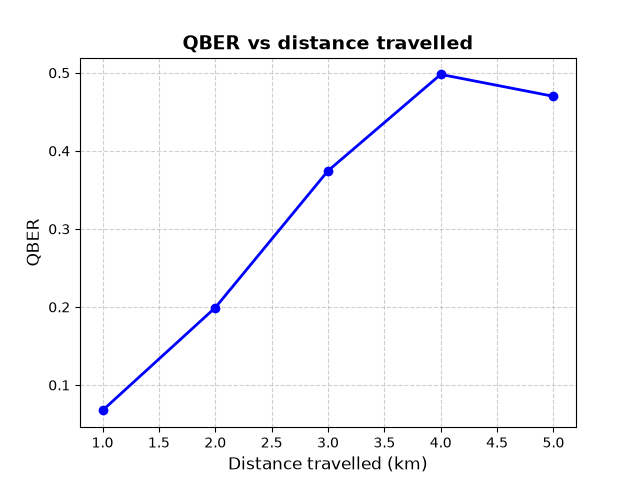

# BB84 Quantum Key Distribution under Birefringence Noise — QSVT Hamiltonian Simulation

## Abstract

This module presents a PennyLane implementation of the BB84 quantum key distribution protocol in which the quantum channel is affected by **birefringence noise** in an optical fiber. Instead of modelling the noise as a generic error channel, the unitary evolution $e^{-iHt/\hbar}$ generated by a birefringence Hamiltonian is simulated explicitly on a quantum circuit using **Quantum Singular Value Transformation (QSVT)**: the Hamiltonian is block-encoded, the cosine and sine of $H t$ are obtained through polynomial transformations of its singular values, and both are combined into the complex exponential. The resulting $2\times 2$ evolution matrix is then applied to every qubit travelling from Alice to Bob. After basis sifting, the program reports the sifted key and the estimated Quantum Bit Error Rate (QBER) induced by the channel.

---

## Table of Contents

1. [Repository Structure](#1-repository-structure)
2. [Requirements](#2-requirements)
3. [Problem Formulation and Algorithm Derivation](#3-problem-formulation-and-algorithm-derivation)
   - [3.1 The BB84 Protocol](#31-the-bb84-protocol)
   - [3.2 Birefringence Hamiltonian](#32-birefringence-hamiltonian)
   - [3.3 Block Encoding](#33-block-encoding)
   - [3.4 Quantum Singular Value Transformation](#34-quantum-singular-value-transformation)
   - [3.5 Complex Exponential from Cosine and Sine](#35-complex-exponential-from-cosine-and-sine)
   - [3.6 Important](#36-important)
   - [3.7 Time Rescaling and Step Splitting](#37-time-rescaling-and-step-splitting)
   - [3.8 Sifting and QBER](#38-sifting-and-qber)
4. [Implementation and Execution](#4-implementation-and-execution)
5. [References](#5-references)

---

## 1. Repository Structure

```
.
├── BB84-noiseless.py       # BB84 transmission
├── BB84-birefringence.py   # Hamiltonian simulation via QSVT, BB84 transmission, sifting and QBER
├── qber-vs-distance.png    # QBER vs. fiber distance plot
├── LICENSE                 # MIT License (code)
├── LICENSE-DOC             # CC BY 4.0 (written content and derivations)
└── README.md               # This file
```

---

## 2. Requirements

* Python 3.10+
* [PennyLane](https://pennylane.ai/) — a recent version providing `poly_to_angles`, `PrepSelPrep`, `PCPhase`, `QSVT` and the `default.qubit` device. It also supplies the autograd-wrapped NumPy (`pennylane.numpy`) used for array handling.

Install with:

```bash
pip install pennylane
```

Run with:

```bash
python BB84-birefringence.py
```

---

## 3. Problem Formulation and Algorithm Derivation

### 3.1 The BB84 Protocol
The BB84 protocol is considered the first example of a Quantum Key Distribution protocol, this meaning it allows them to share a private key securely by exploiting different characteristics of quantum mechanics.

To derive the working principles of this protocol it is first necessary to introduce the two ends of it: the sender, *Alice* and the receiver, *Bob*.

#### 1. Alice's role

Alice begins by generating a random array of classical bits, with $a\in \{0,1\}^N$, where $a$ represents the bits chain. 

After that she also generates a random array of bases in which she will encode her message $b_A \in \{Z,X\}^N$ where $b_A$ represents Alice's bases and $Z,X$ represent the Z and X bases respectively.

For both of the previous arrays $N$ represents the number of bits that Alice uses.

After that she follows quite a simple rule:

- If $b_A=Z$ then: if $a_i=0$ she sends the state $|0\rangle$, else if $a_i=1$ she sends $|1\rangle$.

- If $b_A=X$ then: if $a_i=0$ she sends the state $|+\rangle$, else if $a_i=1$ she sends $|-\rangle$.

(Please note the nomenclature used in this README differs from the original nomenclature used in the original BB84 paper. The reason being that the original paper uses the polarization direction to represent the states, something less elegant or common nowadays than using Dirac's notation).

Alice now sends her states to Bob, always keeping the same order in which she prepared them.

#### Bob's analysis
Once Bob receives Alice's states he needs to perform a measurement, however, he does not know in which base Alice codified each state. Thus, he creates a random array of bases, just like Alice did before, let us call them $b_B \in \{Z,X\}^N$.

Once Bob has his array, he measures each qubit (again, keeping always track of the order) with the corresponding basis. However, two things can happen here:

- The base he is measuring in is the same that Alice used for encoding, in that case, he will always obtain the bit that Alice wanted to send. For example, if Alice encoded $|0\rangle$ (by using Z base) and Bob measured on Z base $$ P(0)=||M_0|0\rangle||^2=1 $$ (where $M_0$ is the projector over state $|0\rangle$ in base Z) i.e he will always obtain 0, no matter what.

- On the contrary, if Bob measures over the wrong base he will randomly obtain one of the two possible values of the classical bit $$P(+)=||T_+|0\rangle||^2=\frac{1}{2} $$ (where $T_+$ is the projector over state $|+\rangle$ in base X). Same result for $P(-)$. Thus, this measurement might not be correct.

Therefore, what Alice and Bob do now is share their basis arrays using a public channel.

#### Sifting

Once Alice and Bob see each other's arrays of bases they check which of the positions have the same basis and keep those positions. They will only use the bits in those positions to create the private key, the others will be discarded.

Finally, they have obtained the private key.


### 3.2 Birefringence Hamiltonian

Let us now model how the transport of the states (typically photons) affects the final result. More precisely, how the birefringence of the optical fiber through which photons travel affects this whole process.

To do so, it is necessary to define a Hamiltonian, in this case

$$
H_{fiber}=\frac{\hbar}{2}(\Delta \omega \sigma_z+ \Omega \sigma_x),
$$

where  $\Delta \omega =10^6 $ rad/s, being the difference between the effective angular frequency associated to the birefringence. And $\Omega=5\cdot 10^5$ being the intensity of the second effective component. Please note that both these values are merely speculative and for learning purposes only.


### 3.3 Block Encoding

Typically, with such a Hamiltonian one would just apply the evolution caused by it directly. However, the aim of this repository is to show how a cutting-edge technique such as QSVT can be used to encode a non-unitary Hamiltonian and apply it to a circuit. Therefore, we should begin by imagining our Hamiltonian as non-unitary. In that case we would like to embed it in an actual **Unitary matrix**, this process is called **Block Encoding**. 

Our Hamiltonian is a Linear Combination of Unitaries (LCU), as such, a PrepSelPrep routine works perfectly in order to encode it. This routine needs two sets of wires: the main register (wires on which the evolution is applied, in our case the wire in which Alice codifies her states) and the auxiliary register/wires. The latter are necessary for the PrepSelPrep routine. 

In order to find how many auxiliary wires are necessary one needs to check the terms in the LCU of the hamiltonian. In this case, there are two terms. In order to encode them as the PrepSelPrep routine requires we need $\log_2(2)=1$ auxiliary wire.

After applying the PrepSelPrep routine, we obtain our Hamiltonian (of original dimension $2^1$ since it is only applied to 1 wire) encoded in a bigger matrix (of dimension $2^2$ since we used two wires for its creation). The Hamiltonian is located at the top-left of this new **unitary** matrix.


### 3.4 Quantum Singular Value Transformation

The QSVT applies a polynomial transformation to a matrix. In our case, we wish to apply this transformation so that our Hamiltonian becomes the operator
$$
e^{iHt}.
$$
To do so, it is necessary to first divide the exponential into polynomials. Of course $e^{ixt}=\cos{xt}+i \sin{xt}$ and we can then expand the sine and cosine as a Taylor Series, thus obtaining polynomials. The coefficients of said polynomials need then to be turned into angles, however PennyLane offers a function that directly performs this step and will thus not be explained.

To encode these polynomials separately we need to first create the circuit. To do so we need: the unitary matrix that contains our Hamiltonian embedded and a **Projector operator**. There is a specific projector operator for each angle from the previous step and they need to be interleaved with the unitary matrix for each step. However, depending on the type of polynomial (even or odd) the order varies. The demonstration goes beyond the scope of this document, and luckily PennyLane already has a module to this step for us.

Of course, the projector operators need to be applied in precisely the same 2 wires as the unitary matrix is working on.

A last and quite important step is to obtain only the **real part** of the encoded polynomial. To do so, we need an extra auxiliary wire in which we will apply Hadamard gates and that will control the QSVT gates.

We now have the real part of the cosine and the sine encoded.


### 3.5 Complex Exponential from Cosine and Sine

At this point, we want to build the complex exponential $e^{ixt}=\cos{xt}+i \sin{xt}$ inside of our circuit. To do so, we apply a procedure that is almost the same as the algorithm applied to obtain the real part of the polynomial, just including an S gate between the two QSVT (one for the cosine, and one for the sine. This applies the complex phase $i$ to the sine).

Finally, we have a unitary matrix in which we have encoded our evolution operator, more precisely in the top left, in a sub-matrix of dimension $2^{\text{working wires}}$, i.e 2 for our Hamiltonian.


### 3.6 Important

The matrix obtained in the previous section is a **unitary** acting on four wires (the system wire plus three auxiliary wires), and the evolution operator is only a *block* of it. Therefore, it cannot be applied to the system qubit just by running the circuit: the auxiliary wires have to be taken into account.

Let $U$ be the full circuit, $|\psi\rangle$ the state of the system wire and $|000\rangle$ the initial state of the three auxiliary wires (wires 0, 1 and 2). After the circuit, the state can be split into two orthogonal parts:

$$
U\left(|000\rangle\otimes|\psi\rangle\right)=|000\rangle\otimes \frac{1}{2}e^{iHt}|\psi\rangle+|\text{rest}\rangle,
$$

where $|\text{rest}\rangle$ contains all the components in which at least one of the auxiliary wires is **not** in $|0\rangle$. The factor $\frac{1}{2}$ comes from the combination of the cosine and the sine through wire 0 and the Hadamard gates (note that this block is only approximately $\frac{1}{2}e^{iHt}$, since the Taylor series has been truncated).

On a real quantum computer the procedure would therefore be:

1. Run the complete circuit, including all the auxiliary wires.
2. Measure wires 0, 1 and 2.
3. Keep **only** the shots in which the three of them are $0$ and discard the rest.

When this happens, the state of the system wire is proportional to $e^{iHt}|\psi\rangle$, which is the evolution we were looking for. All three wires are needed: if only some of them were post-selected, other blocks of the matrix would contribute to the result.

This has a cost. The probability of obtaining all zeros is

$$
P_{\text{success}}=\left\|\frac{1}{2}e^{iHt}|\psi\rangle\right\|^2=\frac{1}{4}
$$

for each time step. If the evolution is split into $N$ steps (see the next section), each one of them needs its own post-selection, either by measuring the auxiliary wires after every step or by using new auxiliary wires for each one of them. The total probability of success is then of the order of

$$
P_{\text{total}}\sim\left(\frac{1}{4}\right)^N,
$$

which decreases exponentially with the number of steps and, therefore, with the length of the fiber.

**What the program does.** The simulator gives access to the whole matrix of the circuit, so instead of measuring and discarding shots, the program slices the top-left $2\times 2$ block of the matrix (the one that corresponds to the auxiliary wires in $|000\rangle$) and multiplies it by 2 to remove the factor $\frac{1}{2}$. This is exactly the operator that would be obtained by post-selecting, but without paying the cost of the discarded shots. Consequently, the results of this repository must be understood as an **idealized simulation** of the evolution: they show how the birefringence affects the BB84 protocol, but not the resources that a real implementation of this circuit would require.


### 3.7 Time Rescaling and Step Splitting
After the previous **crucial** explanation, it is understandable that we are now applying $e^{i \tilde{H}t}$ where $\tilde{H}$ is the normalized Hamiltonian of our original one (this is compulsory for encoding).

 It is also necessary to realize that, having applied a Taylor expansion, $t$ needs to be small ($<1$) for it to work as intended, but, depending on the distance travelled and the speed of the photons this might not be the case. To address this problem, one divides the evolution into small steps, since $e^{i\tilde{H}t}=(e^{i\tilde{H}t/N})^N$ exactly. Also, if the goal is to obtain the evolution for our Hamiltonian (not the normalized one) one should choose our time to be $\frac{t\cdot \text{normalization}}{ N}$ so that it takes out the normalization of the Hamiltonian and still respects the step approach.

Finally, any evolution operator has to be $e^{-\frac{i}{\hbar}Ht}$ as stated by Schrödinger's equation. Thus, the final time per step is
$$
t_{step}=\frac{-t\cdot\text{normalization}}{N\cdot \hbar}
$$


### 3.8 Sifting and QBER

The noise is now applied when the photons are being transferred from Alice to Bob, and then, the protocol follows exactly the same approach: Bob obtains his bases, measures, they share their bases publicly and they each obtain the private key.

However, the private keys might not be equal: the noise introduced can change the states so that, even measuring over the same base returns different bits.
The ratio that measures how much this happens is called QBER:

$$
QBER=\frac{\text{Erroneous bits after sifting}}{\text{Total bits after sifting}}
$$


---

## 4. Implementation and Execution

The program is organized in the following blocks, all contained in `BB84-birefringence.py`:

### 4.1 Circuit layout

The simulation uses a 4-qubit `default.qubit` device with the following wire assignment:

| Wire | Role |
|------|------|
| 0 | Ancilla used to combine the cosine and sine circuits into $\cos + i\sin$ |
| 1 | Ancilla used to extract the real part of each polynomial transformation |
| 2 | Control wire of the block encoding (`PrepSelPrep`) |
| 3 | System qubit: the qubit the Hamiltonian acts on and the one transmitted through the channel |

### 4.2 Hamiltonian and block encoding

* The birefringence Hamiltonian is written as a linear combination of Pauli operators, $\sigma_z$ and $\sigma_x$ on wire 3, with coefficients `5.273e-29` and `2.636e-29`.
* The coefficients are divided by their 1-norm so that the block-encoded operator has norm $\le 1$; the norm is kept to restore the physical scale later.
* The normalized Hamiltonian is block-encoded with `qp.PrepSelPrep`, using wire 2 as control.

### 4.3 QSVT circuits

* `cosine_angles(t)` and `sine_angles(t)` build the degree-4 Taylor polynomials of $\cos(tx)$ and $\sin(tx)$ and convert them to QSVT phase angles with `qp.poly_to_angles`.
* `cos_projectors(t)` and `sin_projectors(t)` turn those angles into `qp.PCPhase` projector-controlled phase gates acting on wires `[2, 3]`.
* `circuit_cos(t)` and `circuit_sin(t)` apply the QSVT sequence and its adjoint, controlled on wire 1, to obtain the real part of the transformation.
* `qsvt_hamiltonian_evolution(t)` combines both circuits through wire 0 and returns the full state, from which the unitary matrix of the circuit is extracted.

### 4.4 Evolution matrix

* The effective time is $t_{\text{eff}} = \|H\|_1\, t_{\text{phys}} / \hbar$, with $t_{\text{phys}} = L/v$, $L = 4\times10^3$ m of fiber (the default value in the script) and $v = 2\times10^{8}$ m/s.
* To keep the Taylor approximation accurate, the evolution is split into `N` identical steps of duration `-t_eff / N` (the minus sign comes from the evolution operator $e^{-iHt/\hbar}$, see [3.7](#37-time-rescaling-and-step-splitting)). The number of steps is scaled proportionally to the fiber length (10 steps per km, e.g. `N = 10` for 1 km, `N = 40` for 4 km (the default in the script) and `N = 100` for 10 km), so that the duration of each step, and therefore the Taylor truncation error, stays constant for every distance.
* The circuit matrix is computed with `qp.matrix`, multiplied by 2 to remove the overall $1/2$ factor, and the top-left $2\times 2$ block (the part acting on the system qubit) is sliced and rounded to 4 decimals. This block is the single-step evolution matrix.

### 4.5 BB84 transmission

For each of the `number_of_bits = 500` transmissions, the function `transmission(noise_matrix, steps)`:

1. Chooses Alice's random bit and random basis (`Z` or `X`) and Bob's random measurement basis.
2. Prepares the corresponding state on wire 3.
3. Applies the single-step evolution matrix `N` times with `qp.QubitUnitary`, modelling the birefringent fiber.
4. Rotates to the `X` basis with a Hadamard if Bob measures in `X`, and measures wire 3 with one shot.

### 4.6 Sifting and QBER

* Only the positions where Alice's and Bob's bases coincide are kept.
* The secret key is built from Alice's bits at those positions and printed.
* The QBER is the fraction of sifted positions where Alice's and Bob's bits differ, and is printed as `Estimated QBER`.

### 4.7 Output

```
The secret key is:   [ ... ]
Estimated QBER:      <float between 0 and 1>
```

Since bits and bases are chosen at random, the key and the QBER change from run to run.

### 4.8 Main parameters

| Parameter | Value | Meaning |
|-----------|-------|---------|
| `number_of_bits` | 500 | Number of qubits sent through the channel |
| `L` | $4\times10^3$ m (default) | Fiber length; varied between 1 km and 10 km in the QBER vs. distance study |
| `v` | $2\times10^{8}$ m/s | Light propagation speed in the fiber |
| `N` | 40 (default, for 4 km) | Number of evolution steps, scaled as 10 steps per km to keep the Taylor error constant |
| `hbar` | $1.054571817\times10^{-34}$ J·s | Reduced Planck constant |

### 4.9 QBER vs. distance

The script was run for 500 bits and for fiber lengths between 1 km and 10 km, scaling the number of evolution steps as 10 steps per km (see [4.4](#44-evolution-matrix)) so that the Taylor truncation error is the same for every point.



*Figure 1. Estimated QBER as a function of fiber length.*

---

## 5. References

### Primary Papers & Textbooks
1. **Bennett, C. H., & Brassard, G. (1984).** Quantum cryptography: Public key distribution and coin tossing. *Proceedings of IEEE International Conference on Computers, Systems and Signal Processing*, Bangalore, India, pp. 175–179.
2. **Gilyén, A., Su, Y., Low, G. H., & Wiebe, N. (2019).** Quantum singular value transformation and beyond: exponential improvements for quantum matrix arithmetics. *Proceedings of the 51st Annual ACM SIGACT Symposium on Theory of Computing (STOC)*. Available at: [arXiv:1806.01838](https://arxiv.org/abs/1806.01838)
3. **Martyn, J. M., Rossi, Z. M., Tan, A. K., & Chuang, I. L. (2021).** Grand Unification of Quantum Algorithms. *PRX Quantum*, 2, 040203. Available at: [arXiv:2105.02859](https://arxiv.org/abs/2105.02859)
4. **Low, G. H., & Chuang, I. L. (2019).** Hamiltonian Simulation by Qubitization. *Quantum*, 3, 163. Available at: [arXiv:1610.06546](https://arxiv.org/abs/1610.06546)
5. **Nielsen, M. A., & Chuang, I. L. (2010).** *Quantum Computation and Quantum Information* (10th Anniversary ed.). Cambridge University Press.
   DOI: [10.1017/CBO9780511976667](https://doi.org/10.1017/CBO9780511976667)

### Software
6. **Bergholm, V., et al. (2018).** PennyLane: Automatic differentiation of hybrid quantum-classical computations. *arXiv preprint*. Available at: [arXiv:1811.04968](https://arxiv.org/abs/1811.04968)
7. **PennyLane Documentation.** Available at: [docs.pennylane.ai](https://docs.pennylane.ai/)

## License

The code in this repository is licensed under the [MIT License](LICENSE).
The written content and mathematical derivations in this README are licensed
under [CC BY 4.0](https://creativecommons.org/licenses/by/4.0/) —
you are free to share and adapt them, provided you give appropriate credit
with a link back to this repository.